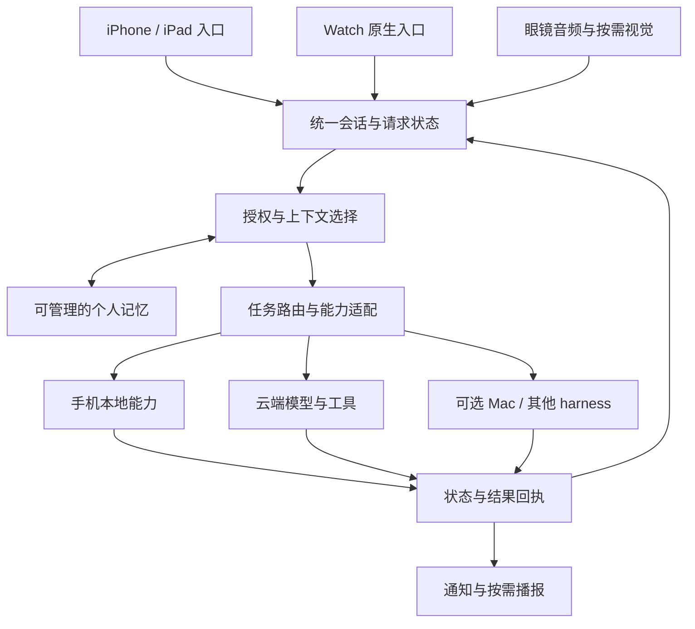

# 个人 AI 前台产品：前期调研与验证路线

日期：2026-11-16。当前阶段：先做创始人自己的日用产品，再邀请小范围用户内测。首发公开市场尚未选定。

## 1. 产品定义与本轮建议

产品定义：**让用户在常用设备上，以尽可能少的操作，把现实中的问题、想法和情境交给 AI，并持续得到可追溯的帮助和执行结果。**

用户拥有的是同一个个人助理：手机承接主要交互与设备连接，手表负责随手输入与短反馈，眼镜提供音频及按需视觉，平板负责阅读、整理和确认复杂结果。模型、云服务、家中 Mac 和不同 harness 是可替换的能力来源。

建议的首发承诺是：**随口记录，结合自己的信息追问，交办任务有回音。** 愿景可扩展到全天情境理解，首轮验证围绕三个重复出现的日常场景：

| 场景 | 用户原话示例 | 完成的定义 |
|---|---|---|
| 随手捕捉 | “记一下，下次改首页先解决首次录音权限。” | 信息已保存，可改正；以后能找回 |
| 带上下文提问 | “我上次为什么决定先做手表？” | 基于用户授权的记录回答，并能打开来源 |
| 交办与跟进 | “按刚才想法做一份竞品比较，完成后告诉我。” | 明确已接单、执行状态和最终结果；失败有说明 |

选择“高频使用 Apple 设备、已有明确工作任务、经常离开桌面”的独立工作者作为第一批测试对象。你本人先是第一个样本，随后加入不同职业与设备组合的测试者，检验其他人是否也能独立养成使用习惯。

这轮建议更新为：**自有 SwiftUI 前端＋统一的会话/记忆/任务协议，Omi 作为个人记忆产品参考，Chums 作为手表参考，OpenVision 作为眼镜参考；Remodex 保留为 Mac 编码执行适配的参考。**

上述选型是工程判断。没有在本轮构建 App、运行硬件实验、验证市场需求或测得转化率。

## 2. 竞争格局：需要验证什么差异

| 类别与参考产品 | 公开信息 | 对本产品的启发 |
|---|---|---|
| Apple Siri AI | Apple 2026 年发布说明涵盖个人上下文、屏幕内容与跨应用操作；实际可用性仍要按系统、设备、语言、地区确认 | 系统原生入口是强竞争项，也可通过 App Intents 成为分发入口；单纯语音问答很难形成持久差异 |
| Perplexity 等通用语音助手 | Perplexity 已公开 iOS 语音执行动作与 Action Button 入口 | “少点几下”是必要体验，应与现成助手实测比较 |
| Omi | MIT 开源，涵盖手机、桌面、硬件与记忆链路；移动端为 Flutter | 新目标下最相关的开源对照，借鉴采集、记忆、任务及数据控制；整个仓库复用会引入较大系统依赖 |
| Plaud NotePin | 以随身录音、转写、总结与资料检索为明确用途 | 用户更容易理解一个具体结果；录音必须转成可用产物 |
| Limitless | 官方公告被 Meta 收购，并从 2025-12-05 停售 Pendant | 数据可导出、供应商变动与退出安排，需要从产品早期设计 |

来源：[Apple Siri AI 发布说明](https://www.apple.com/newsroom/2026/06/apple-introduces-siri-ai-a-profoundly-more-capable-and-personal-assistant/)、[Perplexity iOS 语音入口](https://www.perplexity.ai/changelog/what-we-shipped-april-25th)、[Omi](https://github.com/BasedHardware/omi)、[Plaud NotePin](https://www.plaud.ai/products/plaud-notepin)、[Limitless 官方公告](https://www.limitless.ai/)。

应验证的差异是：多设备之间保持同一件事的连续性、用户可管理自己的记忆、任务执行后有可信回执，以及在真实环境下稳定快速的入口。使用相同模型做对照，更能判断前端本身有没有价值。

Omi 本轮固定检查 README、移动端 README、根 LICENSE，提交为 `bea81bfcf71578ed0f9f0860250cde408e702529`。确认移动端为 Flutter、根许可证 MIT；没有据此认定其全部功能在自己的部署或全部硬件上即刻可用。若原生 Apple 体验是核心优势，建议以模块和产品机制为参考，自建小范围前端，再逐步增加适配。

## 3. Apple 设备上的快速入口与边界

| 设备/入口 | 第一版用途 | 需要验证的边界 |
|---|---|---|
| iPhone Action Button | 直接进入听取请求或快速记录 | 设备须有该按钮、用户须配置；冷启动、锁屏、权限与音频路由分别测量 |
| 锁屏/控制中心 Control、Widget | 一次操作开始明确动作或进入对应界面 | 系统入口不自动保证任何后台动作都能运行；敏感内容可要求认证 |
| Siri/App Shortcuts | “用某 App 记一下”等入口 | 语言、短语识别、解锁及系统可用性要实测 |
| Apple Watch complication、Smart Stack、Control | 按一下讲话、看任务状态、确认短操作 | 原生 Watch 控件与镜像 iPhone 控件不同；手表不能只当作永远在线的手机遥控器 |
| Ray-Ban Meta 音频 | 活跃会话内说话、听简报 | 蓝牙输入输出、回声、来电、锁屏与重连需要实体眼镜验证 |
| Meta 官方语音唤起 | 开发/beta 验证免手动启动 | 本轮沿用 DAT 1.0.1 文档：Voice Invocations、Speech、Camera Audio Streaming 为实验功能，暂不可用于正式发布渠道 |
| iPad | 共享文本/图片、审阅长结果、管理记忆 | 复用主要会话与数据模型，第一版先做自适应界面 |

Apple 的 App Intents、WidgetKit Controls 已为 Control Center、Lock Screen、Action Button 等提供接口。它们应接入同一套动作与状态模型。[App Intents](https://developer.apple.com/documentation/appintents)、[Controls](https://developer.apple.com/documentation/widgetkit/creating-controls-to-perform-actions-across-the-system)。

**不要把 iPhone 侧边键当成全球统一的第三方助理入口。** 当前 Apple 文档明确把相关能力限制在日本，需要相应 entitlement；生产设备还要求 Apple Account 地区为日本且人在日本。[官方侧边键文档](https://developer.apple.com/documentation/appintents/launching-your-voice-based-conversational-app-from-the-side-button-of-iphone)。

watchOS 26 支持 Controls 放入控制中心、Smart Stack 等位置。镜像 iPhone Control 的动作在手机执行，需要前置 iPhone App 的 Control 不显示在手表；想直接使用手表麦克风，需实现相应原生 Watch 体验。[watchOS 26 官方说明](https://developer.apple.com/videos/play/wwdc2025/334/)。

WatchConnectivity 要区分即时消息与后台传输，后者由系统安排时间。不要用某一次 `sendMessage` 成功代表所有后台状态都可靠。[WatchConnectivity 数据传输](https://developer.apple.com/documentation/watchconnectivity/transferring-data-with-watch-connectivity)。

用户在公共场所不一定愿意说话。语音之外，保留共享菜单、照片、选中文字和短文本入口，允许环境决定最快的操作方式。

## 4. 首版产品范围与交互

### 必须完成的闭环

1. 入口触发后立即给出触觉或声音反馈，清楚显示是否真的开始收音。
2. 用户可说“问一下”“记住”“帮我做”，必要时由系统追问一句；信息先可靠落盘，断网也可保留草稿。
3. 明确区分已保存、已提交、正在执行、等待用户、完成、失败，跨设备可继续同一件事。
4. 回答个人历史时能查看来源；任务完成提供产物、链接或可核验的执行回执。
5. 用户能暂停录音、停止播报、取消任务、改正文字、纠正记忆、删除记录。

手机主界面可先围绕“立即说/记”“正在办的事”“自己的记录”设计。手表只展示短状态和短操作；复杂确认转到手机。平板复用同一资料与任务，不在首版单独扩张功能面。

首次使用引导是核心开发工作：只在首次录音时申请麦克风权限，完成第一次真实请求，再引导设置最适合此设备的入口。模型登录、所有权限、按钮配置、通知授权不要都压在第一屏。

对数字、时间、人名、收件人和公开发布内容，提供简短核对。普通“记一条想法”可快速保存；对外发送、付款、删除等动作采用明确的能力授权与必要确认。取消要说明实际执行到哪一步，不能承诺撤销已经完成的外部动作。

### 后续增加的范围

独立蜂窝 Watch、眼镜免手动唤起、全天环境录音、实时视频理解、自建插件市场、同时接多种 harness，分别作为独立版本验证。自用阶段可在自己设备上提前实验其中一项，内测承诺仍以稳定的已支持能力为准。

## 5. 与 harness 无关的技术结构

### 自己掌握的部分

| 模块 | 需要做的工作 |
|---|---|
| 原生入口与状态机 | SwiftUI、App Intents、Controls、Widgets、Watch；冷启动、权限与路由处理 |
| 音频交互 | 收音、VAD、转写、结束说话检测、流式播报、打断；电话/音乐/蓝牙中断恢复 |
| 会话连续性 | 稳定请求 ID、跨设备会话、离线队列、幂等提交、重连补拉 |
| 个人记忆 | 原始事件、来源、事实与推断分离、可纠正摘要、检索、导出与删除 |
| 任务执行 | 能力查询、提交、中止、待确认项、结果与产物；先实现一种适配器 |
| 通知 | 完成、失败、等待回答/确认；APNs 与通知点击定位，不泄露锁屏敏感内容 |
| 运维与质量 | 崩溃、粗粒度性能、费用额度、失败追踪、版本发布、备份恢复 |

对 harness 的统一协议只要覆盖“支持哪些能力、接单、状态、确认、取消、结果”即可。第一版用一种执行端走通，再增加第二种验证抽象是否合理。更换执行端时，用户的记录、任务 ID 与前端习惯仍应保留。

家中 Mac 适合自己的首个实验执行节点。面向普通内测者时，基本问答与记录应能直接在手机/服务端工作；把“先配一台常开 Mac”保留给需要桌面执行的高级能力。

本地转写可评估 SpeechAnalyzer/SpeechTranscriber，运行时检查设备与语言支持；不支持时给出清楚的可选替代。Foundation Models 可用于部分本地整理与分类，也应按设备、地区与模型可用性检测。[SpeechTranscriber](https://developer.apple.com/documentation/speech/speechtranscriber)、[Foundation Models 可用性](https://developer.apple.com/documentation/foundationmodels/generating-content-and-performing-tasks-with-foundation-models)。

## 6. 全天环境感知：逐级验证

“全天感知”可由用户授权的时间、日历、主动分享的资料、明确录音会话和少量环境事件共同构成。重点是何种信号能带来可用帮助，以及用户是否愿意持续开启。

| 级别 | 采集方式 | 对用户的价值验证 |
|---|---|---|
| A：主动片段 | 一句话、一张照片、一次分享 | 想法不丢、之后能找回；适合首版 |
| B：明确会话 | 用户开始一段会议/散步整理，结束后总结 | 是否减少记笔记和整理工作；先验证 30–60 分钟会话 |
| C：授权事件 | 用户选择日历、任务等来源，按时生成准备资料或回顾 | 是否减少重复说明，且不制造多余提醒 |
| D：长期环境录音 | 明确开启的长会话，提供常驻状态、暂停、保留策略 | 先作为自用实验，验证增量价值、耗电、干扰与成本 |

iOS 并非全面禁止锁屏录音：有效录音会话、权限与音频后台模式支持继续录音，但来电、闹钟和其他音频会打断。[AVAudioSession 录音说明](https://developer.apple.com/documentation/avfaudio/avaudiosession/category-swift.struct/record)。

采用 `AudioRecordingIntent` 时，Apple 当前文档要求录音期间保持 Live Activity；未启动会停止录音。应按系统版本和实机测试该生命周期。[AudioRecordingIntent](https://developer.apple.com/documentation/appintents/audiorecordingintent)。后台模式要用于其规定用途，不可把静音播放或伪造运动当作产品的常驻基础。

长录音至少要记录中断起止、片段是否完整、待上传数量和恢复结果，让用户看得懂空白是怎么产生的。不要让“正在录音”的界面在麦克风失效后仍显示正常。

### 数据量与费用为何要先算

下面只是算术示例，不是设备实测或供应商报价：

- 16 kHz、16 bit、单声道 PCM：约 32 KB/秒，8 小时约 **0.922 GB/天**。
- 假设压缩音频码率 16 kbps：8 小时约 **57.6 MB/天**，30 天约 **1.728 GB**，不含索引、备份等。
- 每天 8 小时与每天 10 分钟，在都按全部音频分钟计费时，时长成本相差 **48 倍**。

端侧 VAD、压缩、仅传必要片段、先转文字再整理、限制原始音频保留时间，都可评估。是否减少账单取决于供应商按发送音频、会话时长还是其他单位计费。降噪或说话人识别也不能保证准确排除路人，更不能替代需要的告知与授权。

建议首轮记录：关掉屏幕后的每小时额外耗电、温度、断连数、丢失时长、每小时可用记忆数量、回顾中真正有用的条数、用户暂停次数。把日常对照组放在相近的网络、蓝牙、亮度与活动条件下。

## 7. 个人记忆和主动帮助

一条可管理记忆至少包含内容、来源、时间、适用范围和用户是否确认；长期偏好与某次临时决定分开。记忆发生冲突时保留时间及来源，允许用户改正；模型推断不自动变成确定事实。

用户问“我答应了什么”时，要能跳到来源片段。删除时应处理原文、音频、摘要、向量索引和派生条目，并说明备份清除周期。保留原始记录与摘要的关系，才能重算和修正。

被采集的网页、录音和邮件属于资料输入，里面出现的指令不能自行获得操作权限。是否发送消息、调用账户或控制设备，由用户授权与任务流程决定。

主动帮助先选三个可解释触发：用户指定的每日回顾、已授权日历对应的会前准备、真正需要用户处理的任务变化。每次主动提示应能回答“依据什么、为何现在提示”，并允许关闭同类提示、设置安静时段和降低频率。

全天有数据并不等于要全天出声。主动提示的质量以有用率、接受率与打扰投诉衡量；记录了多少小时不能替代价值指标。

## 8. 录音、数据与正式发布的关键事项

当前先做自用和小范围测试，以下决定应在收集他人数据前落实，而不是等公开上架再补。

| 事项 | 具体产品与工程工作 |
|---|---|
| 录音知情 | 明确状态、开始/停止反馈、随手暂停；录到他人时按使用场景和地区确定告知与合法依据 |
| 发给第三方 AI | 告诉用户哪些资料发给哪个服务、用于什么，并取得需要的明确许可；切换供应商可理解 |
| 数据最小化 | 默认只给本次请求必要上下文；原始音频、长期记忆与诊断日志分别设保留策略 |
| 用户控制 | 查阅、改正、导出、删除；建立账号时提供 App 内发起删除账号的路径 |
| 凭证与租户 | 设备配对可撤销、权限范围、Keychain/安全存储、账号隔离；日志避免记录录音和 token |
| AI 执行动作 | 区分草稿与真正执行；重要动作核对对象和内容，留下可核验回执 |
| 隐私声明 | 准备隐私政策、服务条款、App Privacy、供应商处理与保留说明，且与实际实现一致 |

Apple 审核指南要求录制/记录用户活动时明确同意并提供可见或可听提示；个人资料交给第三方 AI 也有明确披露和许可要求。[审核指南 2.5.14、5.1](https://developer.apple.com/app-store/review/guidelines/)、[第三方 AI 条款更新](https://developer.apple.com/news/?id=ey6d8onl)。

有账号创建的 App 需支持在 App 内发起账号删除；不能只让用户取消订阅或卸载。[账号删除](https://developer.apple.com/support/offering-account-deletion-in-your-app/)。商店隐私披露需覆盖自身及第三方 SDK 的实际数据处理。[App Privacy](https://developer.apple.com/app-store/app-privacy-details/)。

加密传输、服务器静态加密、端到端加密要准确说明。云端模型需要读取的资料，会进入相应处理边界；不要仅凭 TLS 或数据库加密宣传“任何人都无法读取”。

**地区分支。** 选择公开市场后再完成对应发布评估。中国大陆需要按服务形态确认 APP 备案、生成式 AI 服务相关要求、生成内容标识、个人信息与跨境处理；使用已合规的模型 API 不自动免除应用自身责任。声纹用于身份识别、行踪等可能涉及敏感个人信息，不能把所有音频一概等同为生物识别数据。[APP 备案](https://www.miit.gov.cn/zwgk/zcwj/wjfb/tz/art/2023/art_920db564162e4312916a01bed6540ad8.html)、[生成式 AI 办法](https://www.cac.gov.cn/2023-07/13/c_1690898327029107.htm)、[内容标识办法](https://www.cac.gov.cn/2025-03/14/c_1743654684782215.htm)、[个人信息保护法](https://www.cac.gov.cn/2021-08/20/c_1631050028355286.htm)。海外市场也需按具体国家/地区核对录音、个人数据、订阅和消费者条款，不能以“全球上线”跳过市场选择。

Meta 的实验能力可按其允许范围用于开发和 beta；正式发布前重新检查最新状态与条款。社区项目的 MIT/Apache 许可证不替代 Meta SDK 的开发者条款。[固定版本的 Voice Invocations 限制](https://github.com/meta/meta-wearables-dat-ios/blob/bbae597cd1c748cd29b9375a1624a8d75b1c9e14/plugins/mwdat-ios/skills/voice-invocations/SKILL.md)。

## 9. 个人开发者的工作安排

以下是**规划假设**：熟悉 Swift 的一名主要开发者，每周约 25–35 小时，采用现成模型/执行服务。8–12 周是小范围 beta 的估计范围，硬件验证、录音或平台审批问题可能拉长；不是四端完整产品的交期。

| 阶段 | 工作 | 交付与进入下一阶段的条件 |
|---|---|---|
| 第 1–2 周 | 记录真实需求；验证 iPhone 快速入口、锁屏、音频中断；试用现有对照产品 | 3 个重复场景、入口能力实测表、明确首版范围 |
| 第 3–4 周 | iPhone 说/记、离线落盘、简单回答、来源查询、一个执行适配器 | 每条请求有可靠状态与回执，网络切换不重复提交 |
| 第 5–6 周 | Watch 原生输入/状态、跨设备接续、完成与待确认推送、记忆改正/删除 | 手机与手表可完成相同请求；丢失和失败可识别 |
| 第 7–8 周 | 自己连续日用两周；修复最常见失败；用眼镜做独立实验 | 对常用场景有稳定使用、耗电与成本记录 |
| 第 9–12 周 | 15–30 人 TestFlight；简化安装、入口设置和反馈；准备品牌与公开测试页面 | 其他人独立完成首次价值，之后主动复用 |

自用版可先不做登录、多租户、订阅和复杂后台管理，但要有备份与导出。开始接收他人数据时，再落实账号隔离、数据删除、额度控制和支持渠道。

你需要承担产品选择、真实场景判断、质量和用户支持。可在内测前安排一次外部 iOS/音频技术审查，以及针对实际发布市场的数据与条款审查；这些是需要时购买的专项服务，不必一开始组建完整团队。

### 成立自己的产品与品牌

先确定可搜索的名称、域名、支持邮箱与基本视觉，再核查应用名、商标和开源署名。品牌主张用实际场景表达，例如“随口记录，随时追问，交办有回音”。

Apple Developer Program 标准年费为 99 美元或当地币种；个人/独资开发者的商店卖方通常显示个人法定姓名。如果希望以组织名展示，按 Apple 组织注册条件准备主体资料。[会员费用](https://developer.apple.com/programs/whats-included)、[注册与卖方显示](https://developer.apple.com/help/account/membership/program-enrollment)。

## 10. 度量：验证前台是否值得独立存在

核心价值指标建议设为：**每周完成、且用户确认有用的现实请求数。** 另记录请求失败或用户放弃的原因，避免只看调用次数。

以下数字是首轮工程与产品目标，不是已测成绩，也不是行业基准：

| 指标 | 首轮目标或定义 |
|---|---|
| 触发到反馈 | 正常状态下约 150 ms 内给出触觉/视觉反馈；与真正开始收音分开统计 |
| 触发到可说话 | 已授权、正常网络的常用途径目标约 1 秒；冷启动、锁屏需解锁分别统计 |
| 说完到首个有用反馈 | 短请求目标中位数 ≤2 秒、P95 ≤5 秒；排除长任务最终完成时间，但计入接单反馈 |
| 请求可靠性 | 离线、恢复和重试不静默丢记录、不重复执行；失败给出明确可恢复状态 |
| 个人资料回答 | 使用授权来源，能追溯；不确定时说明，定期抽查错误记忆与错误引用 |
| 第四周复用 | 示例门槛：20 名激活测试者中至少 10 名，在第 4 周至少 3 天各完成一条有用请求 |
| 付费信号 | 示例门槛：至少 5 名测试者愿意为明确方案实际付费或作出具体承诺，不能只记“感觉不错” |

小样本的比例不代表市场规模。延迟分位数需保留样本量、设备、网络、输入方式与统计窗口；样本很少时先看原始记录和中位数。

至少覆盖：冷/热启动、锁屏、手机不在身边的 Watch、蜂窝/Wi-Fi 切换、断网、蓝牙断连、来电、音乐、中英混说、姓名数字、噪声，以及数据删除后再次检索。使用自己的测试数据或明确授权的样本。

### 自己日用的最小记录表

| 日期/场景 | 本来想做什么 | 入口/设备 | 额外操作数 | 是否被听懂 | 是否完成且有用 | 等待/失败原因 | 若没有本产品会用什么 |
|---|---|---|---|---|---|---|---|
| 每次抽样填写 | 一句真实需求 | 按钮/手表/分享等 | 数字 | 是/否/改正 | 用户判断 | 简短说明 | Siri/现有 AI/笔记/不做 |

先记录需求机会，包括没有成功启动 App 的时刻。只记录成功会话会漏掉最关键的入口失败。

## 11. 费用与收费实验

月可变成本可按下式记录，统一折算到实际货币：

`C = 转写分钟 × 单价 + 实时语音时长 × 单价 + 模型输入输出用量 + 工具/搜索 + 存储备份 + 网络 + 可变支持成本`

分别看轻度、中度和重度用户，以及用量上限。将订阅净收入扣除商店适用费用、退款、税费和上述成本，才有单用户贡献。不要把手机本地计算当成零代价：用户仍承担耗电、发热和存储。

自用阶段先记录真实账单；beta 可免费但设透明额度。正式收费可测试“基础采集与检索＋云端处理额度＋额外用量”，自带模型/自托管适合高级用户选项。避免在掌握重度用户成本前承诺无限全天处理或终身云服务。

商店佣金依地区、协议、资格和产品类型不同；符合并加入 Small Business Program 时有降低佣金的安排，应使用自己适用的条款算账。[Apple 会员与费用](https://developer.apple.com/programs/whats-included)、[Small Business Program](https://developer.apple.com/app-store/small-business-program/)。

首轮不需要立即决定价格。可以在 beta 结束时向同一类用户提供两个清晰方案，观察真实选择和退款原因，再决定标准价格与额度。

## 12. 用户研究与推广方案

### 从自己的习惯走向第一批用户

先邀请 10–15 名有真实工作任务、设备组合不同的人访谈，再从中挑选首批测试者。问题尽量围绕已发生的行为：

1. 最近一次想问 AI，却因为操作麻烦而放弃，是什么时候？
2. 当时用的是手机、手表还是耳机，双手在做什么？
3. 最后用了什么办法，花了多久，什么结果算完成？
4. 哪些东西希望记住，哪些资料完全不希望进入 AI？
5. 是否愿意在旁人面前讲话，什么场景需要静默输入？
6. 任务需要多久回报、在哪个设备回报，才能真正有用？
7. 若试用结束，愿意保留哪个能力，愿意放弃哪个能力？

让用户现场完成一项真实请求，观察是否需要你解释。首次设置入口、第一次获得有用结果、几天后再次调用，都要分别记录。

### 按阶段推广

| 阶段 | 做什么 | 判断依据 |
|---|---|---|
| 自用期 | 用真实设备拍 3 条短演示：走路记录、抬腕提问、交办后拿结果；保持原始等待时间 | 是否能一眼理解、确实比现有方法方便 |
| 首批 beta | 定向邀请 15–30 人，通过 TestFlight；每周简短回访；提供入口设置教程 | 激活、第二次使用、失败原因、支持时间 |
| 扩大测试 | 在合适的 Apple Watch、效率工具、独立开发者社区发布真实案例 | 每个渠道带来的激活用户及第四周使用情况 |
| 公开首发 | 围绕表现最好的一个场景写商店页，准备评测资料和短演示 | 下载到首次价值的转化与付费/留存 |
| 稳定增长 | 内容合作、自然推荐；需要时使用不同商店页面与小额广告实验 | 获客成本、付费贡献、退款与支持成本 |

中文可考虑即刻、小红书、B 站、V2EX 等与你能持续交流的社区；海外可考虑相关 Reddit 社区、独立开发者社区和产品发布平台。渠道适配与社区规则需要分别核对；当前只是候选，未验证哪个渠道最有效。

TestFlight 适合跨 Apple 平台测试，外部测试构建需经过相应 beta 审核。[TestFlight](https://developer.apple.com/testflight/)。公开后可用产品页优化测试商店素材，用 Custom Product Pages 对应不同使用场景。[产品页优化](https://developer.apple.com/help/app-store-connect/create-product-page-optimization-tests/overview-of-product-page-optimization)、[自定产品页](https://developer.apple.com/app-store/custom-product-pages/)。

推广内容应展示具体结果、实际速度与必要设置。演示使用自己的或专门制作的样本，用户记录和环境素材经明确允许后再使用。推荐邀请可发生在用户得到一次有用结果后，分享内容由用户主动选择。

在用户还需要你协助才能用起来，或者每次任务经常失败时，投入大规模买量会放大这些问题。先修复同类用户反复遇到的阻碍，再扩张渠道。

## 13. 当前可以确定的决策与待验证事项

| 决策 | 当前建议 |
|---|---|
| 产品核心 | 原生多设备入口、可管理记忆、持续任务回执 |
| 首位用户 | 你本人；随后引入独立完成任务的外部测试者 |
| 首发场景 | 随手记、结合记录问、交办并收到结果 |
| 首发平台 | iPhone 主体＋有限 Watch 能力；iPad 自适应；眼镜独立实验 |
| 代码复用 | Omi/Chums/OpenVision 模块与机制参考；自己掌握会话与数据模型 |
| 执行端 | 先一种，Mac 为自己的可选执行节点，协议允许后续替换 |
| 长期录音 | 明确启动、可暂停的会话先行，全天模式另测增量价值 |
| 市场与价格 | beta 后根据真实设备、地域、用量与支付选择确定 |

待验证的核心假设有四个：用户会反复使用快速入口；个人记录能提高回答与执行的质量；任务反馈足够可靠；这些价值能覆盖数据处理、支持与获客成本。当前没有用户研究或运行数据能证明它们成立，以上路线用于尽早获得证据。

## 14. 证据范围

本轮使用官方开发文档、厂商产品说明和开源仓库文档；产品定位、工作量、指标、收费与推广建议均为待验证的规划。竞争产品公开功能不等于所有地区和设备均可用。

关键 Apple 文档与 Omi 文件已下载并校验，来源与 SHA-256 见同目录《个人AI前台产品_来源清单.json》。Apple Controls 的一次本地下载发生 TLS 连接错误，后通过官方网页工具读取成功；Limitless 网页打开发生超时，其公告信息来自官方域名的搜索结果。没有将这两次获取失败解释为产品状态变化。

眼镜与上一轮远程项目的固定源码证据沿用[《苹果生态远程 Codex 开源项目调研》](/Users/eitan/Documents/Codex/2026-11-16/ios/outputs/苹果生态远程Codex开源项目调研.md)，本轮未重新构建或认证其运行效果。
