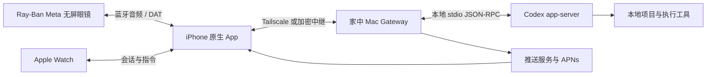

# 苹果生态远程 Codex：开源项目选型调研

调研日期：2026-11-16。目标设备：家中常在线 Mac、iPhone、Apple Watch、Ray-Ban Meta 无屏眼镜。

**建议：以 Remodex 为原生 iPhone＋Mac Codex 底座，参考 Chums 实现手表交互，参考 OpenVision 实现眼镜音频入口。** 如果第一目标就是尽快从手表说话、让 Mac 干活，可以先试 Chums。外网访问可以通过 Tailscale 或自建中继实现，不要求设备处于同一局域网。

本轮没有确认到一个同时覆盖上述四类设备、后台通知完善、眼镜免手动唤起可正式发布、且通用复用授权清晰的成熟一体化项目。各模块已有可用基础，整合与可靠性验证仍是自己的开发工作。

## 1. 需求拆分与结论

| 需求 | 调研结论 |
|---|---|
| Mac 留在家里，人用手机在外面指挥 Codex | 已有多个项目直接覆盖；Tailscale 或中继可跨局域网 |
| 连续对话、继续已有任务、中断、审批、查看工具执行 | 优先采用 Codex app-server 的结构化会话与事件能力 |
| Apple 原生客户端，方便改成自己的版本 | Remodex、Chums；Happy 当前也已有 Swift/UIKit 原生客户端 |
| 手表发语音、查看状态、同意或拒绝操作 | Chums 最直接；Happy Next 也有明确 Watch 功能 |
| 手机锁屏后收到完成或审批消息 | 要检查 APNs 事件覆盖；前台实时流、本地通知不能代替后台远程推送 |
| Ray-Ban Meta 听命令并播报结果 | 有音频路由和语音助手参考项目；推荐让 iPhone 承接眼镜连接与远程会话 |
| “Hey Meta”直接启动自己的 App | 官方已有实验接口，但当前文档不允许将使用它的 App 发布到正式渠道 |
| 全程不用掏手机、长期后台待命 | 尚不能从这些仓库的文档与源码确认；需实机验证唤起、音频、锁屏和重连 |

以下“支持”表示在项目文档或选定源码中找到实现依据，不代表已在用户设备上完成运行测试。

## 2. 主要底座对比

| 项目 | Apple 客户端与 Codex 接入 | 外网路径 | Watch / 语音 | 授权与选型判断 |
|---|---|---|---|---|
| [Remodex](https://github.com/Emanuele-web04/remodex) | SwiftUI iPhone；Node.js Mac bridge；Codex app-server | 自建 relay、Tailscale、WSS/隧道 | 有语音转写代码；未发现 Watch target | Apache-2.0；最推荐的专注型主底座 |
| [Chums](https://github.com/lcoutodemos/chums) | SwiftUI iPhone＋watchOS；Mac Node hub；每个 agent 可使用 Codex | 项目使用 Tailscale Funnel 提供公网 HTTPS，并用 token 鉴权 | 按住说话、工具状态、审批、短语音回复 | Apache-2.0；最贴近手表优先的自用原型 |
| [Happy](https://github.com/slopus/happy) | 当前已有 Swift/UIKit/GRDB 原生 iOS 客户端；多 agent、多端体系 | 加密 relay、自托管服务 | 有语音前台助手；本轮未确认 Watch 实现 | MIT；生态与功能面较广，但整体复杂、正在原生迁移 |
| [Happy Next](https://github.com/hitosea/happy-next) | iPhone 主端为 Expo/React Native；Codex 等多 agent | E2EE、自托管 server | 明确包含 Watch、听写、审批、complication；豆包实时语音 | MIT；接受跨平台主端时的备选 |
| [Mimi Remote](https://github.com/gaixianggeng/mimi-remote) | SwiftUI iPhone/iPad；Go agentd、Mac 菜单栏 | Tailscale；实验 Tailcat；可选付费 Mimi Relay | APNs 通知有文档依据；未确认 Watch | GPLv3＋应用商店分发附加许可；需要接受其派生版本授权要求 |

### Remodex：最适合改成自己的原生 App

它的核心拓扑与目标吻合：Mac 保留项目、Codex 登录和执行环境，iPhone 只负责配对、对话与控制。已有二维码配对、可信 Mac 自动重连、加密传输、历史记录、流式响应、运行中追加指令、排队提示、审批、Git 操作以及 macOS `launchd` bridge 服务。

公开源码包含 iOS、bridge 和 relay，适合在此基础上换品牌、改界面、增加设备入口。但原仓库明确说明项目仍早期、可能存在 bug，不能仅凭功能列表认定稳定性成熟。

自行 fork 需要部署自己的连接端点，并配置自己的签名、APNs 及发布参数。公开仓库不附带原作者生产中继地址、私有发布配置或推送凭证，原版 App 的托管体验不能直接当成 fork 后自动获得的能力。

推送方面，Mac bridge 的 `push-notification-tracker.js` 明确用于 iPhone 断开后继续发出任务完成推送；iOS 通知实现也明确说明挂起后的可靠提醒需要 APNs。本轮确认的是完成通知路径，不能据此断言所有审批和补充问题都已经覆盖后台 APNs。自己版本应逐类补齐“完成、失败、等待审批、等待回答”的事件。

资料：[项目说明](https://github.com/Emanuele-web04/remodex)、[自托管边界](https://github.com/Emanuele-web04/remodex/blob/main/SELF_HOSTING_MODEL.md)、[部署文档](https://github.com/Emanuele-web04/remodex/blob/main/Docs/self-hosting.md)。

### Chums：手表语音体验最贴近需求

它直接把 Mac 上的 Claude Code / Codex 放到 iPhone 与 Apple Watch 上：按住屏幕讲话，Mac 转写并交给 agent，手表显示工具事件、审批卡片和状态，并播报简短回复。文档要求 Apple Silicon Mac、Xcode 26、iOS 26、watchOS 26，需要从源码构建。

它值得借鉴的部分是短语音交互、手表审批、状态反馈以及语音播报，而非只把终端缩到小屏幕。项目选择 Tailscale Funnel，让手表访问一个带 token 的公网 HTTPS 地址；这与 iPhone 加入私有 tailnet 是不同的网络路径。

源码还显示 Watch 客户端以 HTTP 长轮询取事件，`Alerts.swift` 使用本地 `UNNotificationRequest`，Keyring 保活使用 `HKWorkoutSession`。这些实现不能直接证明 App 挂起后仍能及时收到远程事件。若把它作为自己的长期底座，应单独完善后台推送和恢复会话，而不是依赖保持前台。

资料：[架构](https://github.com/lcoutodemos/chums/blob/main/docs/architecture.md)、[Codex 运行时接入](https://github.com/lcoutodemos/chums/blob/main/docs/other-agents.md)。

### Happy 与 Happy Next：要区分当前上游和分支

Happy 当前仓库已有原生 Swift、UIKit、GRDB 客户端，要求 iOS 26、Swift 6.2，不能再简单归类为“只有 React Native”。其原生 README 说明正在承接原 React Native App 的商店版本，记录了原生构建向 TestFlight 的迁移。因此当前源码、公开商店二进制和历史版本的能力需要分别核对。

Happy 的加密同步、relay、多端与语音助手值得参考，仓库还包含 APNs/FCM push server。对只围绕 Codex 开发的个人 App，这套多项目体系比 Remodex 更复杂。托管语音服务可能使用独立供应商和额度，不能假定 Codex 订阅同时覆盖实时语音费用。

Happy Next 是另一个 MIT 分支：主移动端仍为 Expo，加入了 Watch 会话列表、听写、快捷回复、审批和 complication，并采用火山引擎/豆包实时语音。它适合“愿意接受跨平台主端，希望已有 Watch＋中文语音方案”的路线。

资料：[Happy 原生 iOS](https://github.com/slopus/happy/tree/main/packages/happy-ios)、[Happy 语音说明](https://happy.engineering/voice/)、[Happy Next](https://github.com/hitosea/happy-next)。

### Mimi Remote：原生体验备选，先确定自己的授权方向

Mimi Remote 已提供手机端对话、工具执行过程、审批、排队、任务中断等能力，文档描述通过 APNs 推送完成与审批事件。外网可用 Tailscale，另有实验 Tailcat 和可选付费 relay。

其自身代码是 GPLv3，并附应用商店分发许可；附加许可没有取消 GPL 其余要求。Claude bridge 为 GPLv3-only，项目名称与图标另有商标约束。如果计划发布闭源派生 App，不能把它当成 MIT/Apache 一样的默认底座。

它也说明：Codex Desktop 普通 “This Mac” 模式创建的会话不会自动共享；需要共享 app-server 配置。不同项目对桌面会话接续的做法不同，不能把“能远程启动 Codex”与“无缝接管任意现有桌面会话”混为一项能力。

资料：[README](https://github.com/gaixianggeng/mimi-remote)、[许可证](https://github.com/gaixianggeng/mimi-remote/blob/main/LICENSE)。

## 3. Ray-Ban Meta 无屏眼镜：输入、输出与唤起分别评估

无屏眼镜最适合承担“说命令、听简报”的入口，详细 diff、复杂审批和历史仍交给 iPhone。推荐拓扑是眼镜连接 iPhone，再由 iPhone 连接家中 Mac。

### 官方 Meta Wearables DAT

[官方 iOS SDK](https://github.com/meta/meta-wearables-dat-ios)在本轮核对的 1.0.1 版本中，已包含语音识别与语音唤起相关接口，但其可发布状态有明确限制：

| 能力 | 文档依据与当前限制 |
|---|---|
| `MWDATSpeech` | 眼镜语音识别，需相关能力开启与麦克风权限；实验性 |
| Voice Invocations | “Hey Meta, start {app name}”启动或前置 iOS App；需申请能力并配置口述名称；实验性 |
| Camera Audio Streaming | Camera Stream 的音频扩展，需相机与音频流能力审批，以及相机、麦克风权限；实验性 |
| 开发与发布 | 上述实验功能可用于开发与 beta，当前不可发布到正式渠道 |

“唤起自己的 App”并不等于已经可以接管 Meta 系统助手、在任意状态执行任意指令。语言、眼镜代际、地区、固件与锁屏唤起效果仍需按真实设备验证。

不要把 Camera Audio Streaming 直接当成最轻量的纯音频命令通道。第一版可以评估 iPhone 音频会话经眼镜蓝牙麦克风输入、扬声器输出，并用手机或手表显式启动；将官方 Voice Invocations 作为单独实验模块。

Meta SDK 的分发适用 Meta Developer Terms，不是 MIT/Apache；社区 App 的许可证不能替代 SDK 自身条款。

直接依据：[CHANGELOG](https://github.com/meta/meta-wearables-dat-ios/blob/main/CHANGELOG.md)、[Voice Invocations 文档](https://github.com/meta/meta-wearables-dat-ios/blob/main/plugins/mwdat-ios/skills/voice-invocations/SKILL.md)、[Speech 文档](https://github.com/meta/meta-wearables-dat-ios/blob/main/plugins/mwdat-ios/skills/speech/SKILL.md)、[Audio Streaming 文档](https://github.com/meta/meta-wearables-dat-ios/blob/main/plugins/mwdat-ios/skills/audio-streaming/SKILL.md)。

### 可参考的眼镜项目

| 项目 | 可借鉴部分 | 为什么不直接作为整个产品底座 |
|---|---|---|
| [OpenVision](https://github.com/rayl15/OpenVision) | Swift/SwiftUI，iOS 18+；Ray-Ban Meta 音频/相机；“Ok Vision”唤醒词、语音识别、播报、多后端；根许可证 MIT | 是眼镜助手，不是现成的 Mac Codex 远程客户端；需把指令接入自己的 gateway |
| [RayBridge](https://github.com/soothslayer/RayBridge) | 拓扑非常接近：眼镜→iPhone→Mac Codex；文档直接支持 Tailscale、Siri 启动、进度播报、Status/Repeat | 0.1.0 原型；当前语音要求 en-US 本地识别；作者仍要求实体眼镜验证；本轮未确认清晰的通用复用许可证 |
| [VisionClaw](https://github.com/Intent-Lab/VisionClaw) | 可参考 Gemini Live＋眼镜＋OpenClaw 的实时助手链路 | 不是直接的 Codex 移动控制端；本轮根 LICENSE 只见 Meta Developer Terms，不能推断整体 MIT/Apache 复用授权 |

OpenVision 的“Ok Vision”是 App 实现的唤醒方式，不能等同于 Meta 系统级常驻唤起。其 README 说明眼镜/手机音频路由，但本轮没有实机验证长期后台稳定性。也不建议为实现远程控制而在眼镜 App 内另行复用 ChatGPT 登录：它的 README 提醒相关登录可能影响现有 Codex CLI 会话；让 Mac 保持既有 Codex 登录更符合当前需求。

RayBridge 区分单独的 Codex 登录与 “Use this Mac’s Codex login”：前者有只读助手模式，后者使用 Mac 上已配置的 Codex 工具。它展示了可行的交互方向，但不能据 README 把整个硬件链路视为已验证完成。

## 4. 不在同一局域网：两条实际路线

### 个人自用先用 Tailscale

Mac 和 iPhone 加入同一 tailnet，App 连接 Mac gateway 或自建 relay 的私网地址。一般不需要家中固定公网 IP 或路由器端口转发；Tailscale 尝试直连，无法直连时可以通过 DERP 转发。

第一版建议 Watch 和眼镜都通过 iPhone 复用连接。Watch 需要独立蜂窝工作时，再为它提供可达的 HTTPS 服务或独立通知路径。不能假设 iPhone 的 VPN/私网连接会自动让 Watch 具备同样的网络可达性。

资料：[Tailscale 原理](https://tailscale.com/docs/concepts/what-is-tailscale)、[连接类型与 DERP](https://tailscale.com/docs/reference/connection-types)。

### 面向独立 App 体验再做自有中继

若希望用户不另外配置网络工具，可由 Mac 与 iPhone 主动连到自己的公网 WSS relay，再做设备配对、加密、事件同步与推送服务。Remodex、Happy 都有可参考的中继架构，但自己版本需要自己的部署和 APNs 凭证。

此图是建议架构，并不表示这些仓库已经能直接拼接。独立 Watch 客户端的公网入口和 watchOS 推送配置应作为额外分支实现。

## 5. “及时汇报”需要独立设计

| 状态 | 应提供的体验 | 技术重点 |
|---|---|---|
| App 前台 | 实时文字、工具进度、语音状态 | 流式事件、短摘要、可中断播报 |
| iPhone 锁屏或 App 挂起 | 任务完成、失败、等待审批或等待回答通知 | APNs alert、事件分类、点击回到对应会话 |
| 网络切换或短暂离线 | Mac 继续工作，回来后看到完整结果 | Mac 侧持久化、事件序号、去重、重连补拉 |
| Watch 在后台 | 看见需要处理的提醒，再打开处理 | 明确区分 iPhone 通知转发与独立 Watch push |
| 眼镜正在语音会话 | 短句汇报和按需追问 | 音频路由、播报排队、回声与打断处理 |

不能以持续 WebSocket、定时轮询或本地通知代替 APNs。Apple 的后台更新推送也不是持续运行授权，不应承诺每个后台事件必定瞬时到达。通知能出现与结果能自动从锁屏状态在眼镜中朗读，是两项不同能力。

“Mac 不休眠”是必要条件之一，还要保证 gateway/relay 存活、网络可用、Codex 登录有效。锁屏与休眠不同；重启后是否需要登录、服务能否恢复，应在自己的设备上确认。

资料：[Apple 后台更新推送](https://developer.apple.com/documentation/UserNotifications/pushing-background-updates-to-your-app)、[Watch 通知转发](https://developer.apple.com/documentation/watchos-apps/taking-advantage-of-notification-forwarding)。

## 6. Codex 与前台语音 Agent 怎样连接

[Codex 官方 app-server 文档](https://learn.chatgpt.com/docs/app-server.md)将其定位为面向深度客户端集成的接口，包含身份、会话历史、审批和流式事件。当前 stdio 是默认传输，WebSocket 标记为 experimental and unsupported。建议自己的 Mac gateway 本地连接 app-server，再由 gateway 提供鉴权后的远程协议。

前台语音 Agent 可负责把“继续刚才任务”“先解释方案”“停止”“汇报结果”映射到明确的项目、会话与动作，并把执行事件压缩成可听懂的短句。长时间编码与项目状态留在 Mac；手机重连后恢复同一任务。第一版无需额外模型也可以先实现听写＋确定性会话控制，之后再增加能对话的前台 Agent。

要记录稳定的任务/会话标识、事件进度与待审批项，避免一句“继续”启动重复任务。语音前台也应保留 Codex 的审批语义，能向用户准确读出正在申请执行的动作。

Codex 账号及编码额度由 Mac 上的 Codex 使用；另外选用的实时语音、云端转写或语音合成可能单独计费。无需为远程控制把 Mac 上的 Codex 凭证复制到手机或 relay。

## 7. 推荐开发顺序

1. **手机远程闭环：Remodex fork。** 先接自建 relay/Tailscale，用手机蜂窝网络启动和继续 Mac 上的真实任务，验证中断、审批、断线恢复和完成通知。
2. **手表入口：参考 Chums。** 增加原生 watchOS 端，只保留听写、状态、短结果、审批、停止等高价值动作，首先复用 iPhone 通道。
3. **眼镜音频：参考 OpenVision。** 打通眼镜麦克风→识别→同一 Codex 会话→语音播报；先采用显式启动，验证中文、锁屏、来电/音乐打断及蓝牙重连。
4. **免手动唤起与独立产品化。** 在 Meta 实验接口允许范围内验证 Voice Invocations；待可发布条件满足后纳入正式版本。需要脱离手机的 Watch 再实现独立公网连接与推送。

每阶段的完成标准应是设备上的一次完整闭环，而非模拟器构建成功。当前仅完成调研与源码抽查，没有安装上述 App、构建项目、配置用户账号或测试真实眼镜。

其他较小的参考仓库：[agent-watcher](https://github.com/Miraclemin/agent-watcher)、[cmux-iphone](https://github.com/lim-won/cmux-iphone)、[codex-watch-bridge](https://github.com/kirbudilov01/codex-watch-bridge)。它们适合查阅 Watch 界面、听写和连接实现，本轮不优先选作成熟主底座。OpenClaw 可作为多工具编排的备选后端；当前目标围绕 Mac Codex，直接使用 app-server 的底座更聚焦。

## 8. 证据范围与复查入口

本报告结合仓库 README、LICENSE、部署说明、部分实际源码及官方文档。关键源码固定版本如下，其余链接主要为本次下载的 main 分支快照，后续可能变化。

| 仓库 | 本轮核对的提交 | 提交日期 |
|---|---|---|
| Remodex | `c06dcb16a7059603a41e26a2cb4a81b6d4b5514d` | 2026-11-03 |
| Chums | `6821bd6e1aa3d3fb41ca77bd0cc4de0dbbb8097a` | 2026-10-13 |
| Meta DAT iOS | `bbae597cd1c748cd29b9375a1624a8d75b1c9e14` | 2026-10-09 |

关键源码：

- [Remodex iOS 通知](https://github.com/Emanuele-web04/remodex/blob/c06dcb16a7059603a41e26a2cb4a81b6d4b5514d/CodexMobile/CodexMobile/Services/CodexService%2BNotifications.swift)、[Mac 完成推送追踪](https://github.com/Emanuele-web04/remodex/blob/c06dcb16a7059603a41e26a2cb4a81b6d4b5514d/phodex-bridge/src/push-notification-tracker.js)、[relay push service](https://github.com/Emanuele-web04/remodex/blob/c06dcb16a7059603a41e26a2cb4a81b6d4b5514d/relay/push-service.js)。
- [Chums Watch 本地提醒](https://github.com/lcoutodemos/chums/blob/6821bd6e1aa3d3fb41ca77bd0cc4de0dbbb8097a/app/ChumsWatch/Alerts.swift)、[Keyring 保活](https://github.com/lcoutodemos/chums/blob/6821bd6e1aa3d3fb41ca77bd0cc4de0dbbb8097a/app/ChumsWatch/KeepOn.swift)、[Hub 客户端](https://github.com/lcoutodemos/chums/blob/6821bd6e1aa3d3fb41ca77bd0cc4de0dbbb8097a/app/ChumsWatch/HubClient.swift)。
- [Meta Voice Invocations 的发布限制](https://github.com/meta/meta-wearables-dat-ios/blob/bbae597cd1c748cd29b9375a1624a8d75b1c9e14/plugins/mwdat-ios/skills/voice-invocations/SKILL.md)。

下载来源、文件字节数与 SHA-256 保存在同目录的《调研来源清单.json》。GitHub REST API 在本轮遇到未认证限流，已改用原始文件和 git 读取；RayBridge 常规 LICENSE 地址未取得有效文件，因此保留授权未确认结论。项目维护质量、运行稳定性与兼容性没有经过压力测试，排名是面向此需求的工程选型判断。
